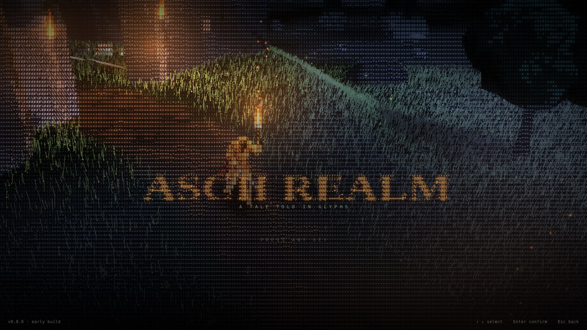
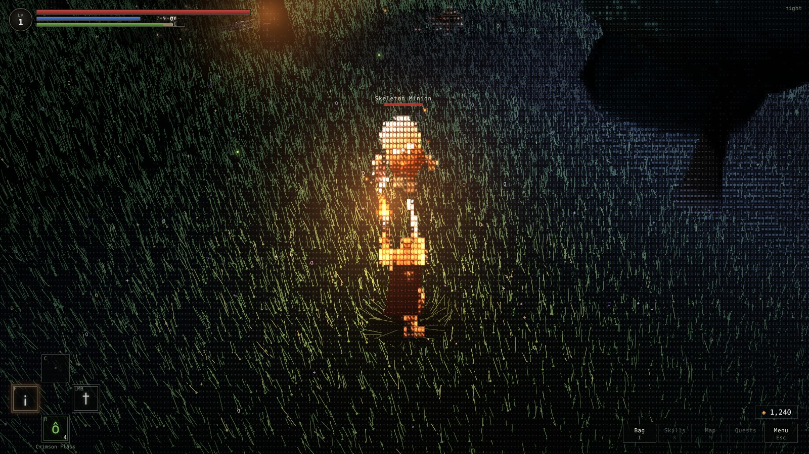
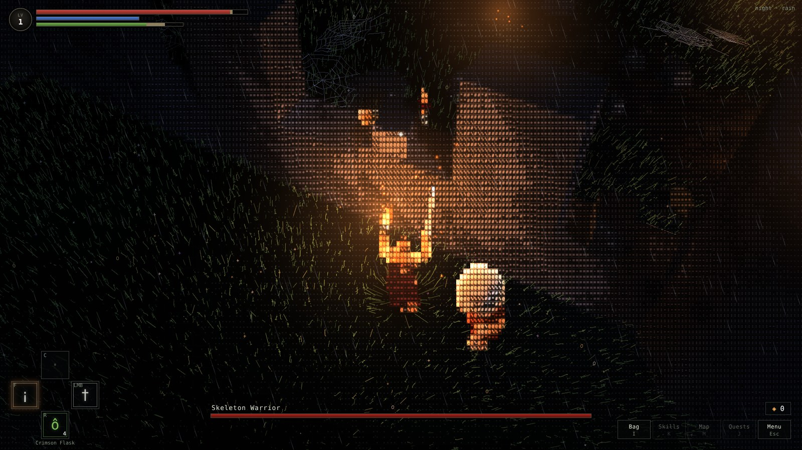
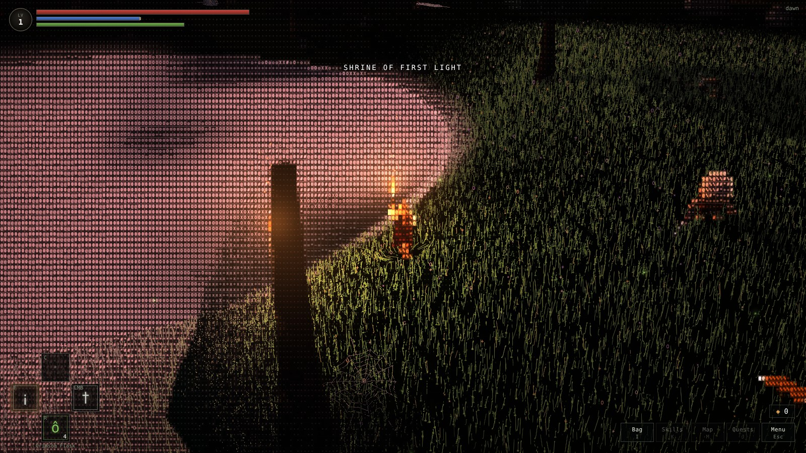
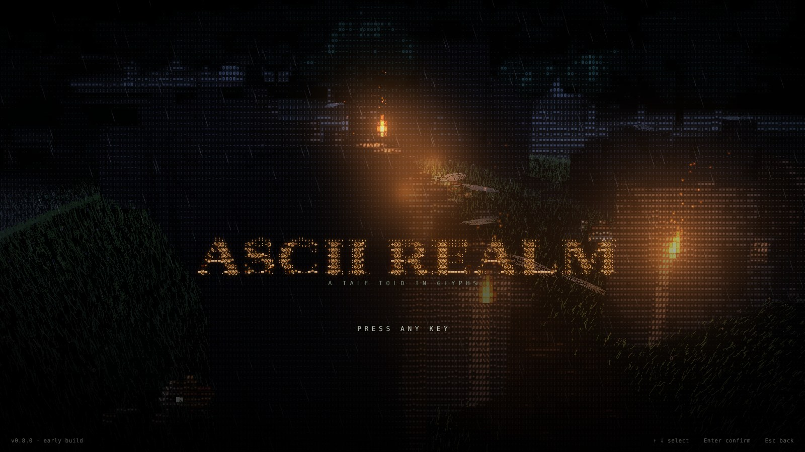

  

<h1 align="center">ASCII Realm</h1>

<b>A souls-like action RPG drawn entirely in glyphs.</b> 
Wind-swept grass that parts around you, torchlit ruins, rain and lightning, skeletons rising from the dark. 
Every frame is a real 3D world, rendered one character at a time.

  <a href="https://github.com/Sanjeeth-Prakash/ascii-realm/releases/latest"><b>⬇ Download for Windows</b></a>
  ·
  <a href="#features">Features</a>
  ·
  <a href="#controls">Controls</a>
  ·
  <a href="#roadmap">Roadmap</a>
  ·
  <a href="CREDITS.md">Credits</a>

---

| | |
|---|---|
|  |  |
|  |  |

## Features

**A world drawn in characters**
- Thousands of grass blades drawn as single glyph strokes (`| l ! i ; j f`) that bend with the wind and part around your feet
- Stone, trees, water and fire are real 3D objects; a shader turns each block of the screen into one coloured character
- Moonlight shadows, dappled light under leaves, drifting cloud shadows, mist over the lake
- Night, dawn, day and dusk; rain with lightning and thunder
- Torches and braziers that light the world. Carry your torch through a cobweb and it burns away, ember by ember
- Ten colour schemes, from full colour to 1-bit and phosphor monitors (inspired by *Return of the Obra Dinn*)

**Souls-like combat**
- Light attacks chain into a 4-hit combo; heavy attacks chain and can be **charged**
- Running attacks, rolling attacks, backstep counters
- Dodge roll with invincibility frames, lock-on, stamina, stagger and hitstop
- Skeletons lie dormant in the grass, rise when you come close and fight with readable, telegraphed swings
- Die and your runes stay where you fell. **YOU DIED.** Go back and claim them

**Elden Ring-style progression**
- Rest at the shrine to heal, refill your flasks and **level up**: Vigor, Mind, Endurance, Strength, Dexterity
- Elden Ring's own stat curves and rune costs
- Golden Seeds and Sacred Tears to grow your Flask of Crimson Tears
- Glowing pickups scattered around the world, monster materials, consumables

**A real game, not a tech demo**
- Title screen with a live in-engine film, options for graphics, audio and every key binding
- Original music and sound: title theme, world track, rain, wind, crickets, fire, footsteps, steel and bone
- Desktop app with borderless fullscreen; saves and settings kept between versions
- **Updates itself**: when a new version is out, the title screen offers it and installs it in seconds

## Download and play

**Windows**

1. Download the game: either `ASCII-Realm-Installer.zip` from **[Releases](https://github.com/Sanjeeth-Prakash/ascii-realm/releases/latest)**, or this whole page with the green **Code → Download ZIP** button
2. Unzip it and run **`Install ASCII Realm.bat`**
3. The first install downloads the game runtime once (about 110 MB, from the official Electron releases, checksum-verified) and adds Desktop and Start Menu shortcuts

From then on the game keeps itself up to date: when a new version is released, the title screen shows **Update to v…**. Saves and settings live in `%APPDATA%\ASCII Realm` and are never touched by updates.

> **From source on any OS** (Node.js 18+): run `start.bat`, `start.command` or `./start.sh` and the game opens in your browser at `http://127.0.0.1:5173`.

## Controls

| Action | Key |
| --- | --- |
| Move / sprint | W A S D / Left Shift |
| Look | Mouse (Esc frees the cursor) |
| Light attack (4-hit chain; sprinting = running slash; after a roll = rolling slash) | Left mouse |
| Heavy attack (2-hit chain, hold to charge) | Right mouse |
| Dodge roll / backstep | Space |
| Lock on, flick the mouse to switch target | Q or middle mouse |
| Drink flask | R |
| Interact: rest at shrine, pick up, retrieve runes | E |
| Torch | F |
| Inventory | I or Tab |

Every key can be rebound in **Options → Controls**.

## How it's made

ASCII Realm is written in JavaScript with [Three.js](https://threejs.org). The 3D scene renders into a small off-screen image where each texel is one character cell. A second pass picks a glyph for every cell by brightness and material (leaves `o 0 8 @`, stone `: = # %`, fire `* x #`) and draws it at full resolution. On top of that grid, a "glyph art" layer draws grass, cobwebs, fireflies and embers as free-floating characters, hidden correctly behind walls and characters. A final pass adds torch glows, rain and the colour scheme.

The whole game is about 20 MB and runs as a desktop app (Electron), forced onto the dedicated graphics card.

Developer notes (architecture, building, releasing): [`docs/DEVELOPING.md`](docs/DEVELOPING.md).

## Roadmap

Where it's heading: a shared open world where **action-RPG build depth** meets **MMO tactics**. A few powerful skills that your whole build is built around, a big passive tree, any item on any character, deep defensive layers (block, evasion, resistances), and a choice of control style: the current action combat or tab-target. Lore you find rather than read off a quest giver: in ruins, in books, and from the bosses themselves. A large world grown from a hand-drawn map with procedural rules, with key places built by hand.

- [x] The world: glyph grass, weather, day and night, colour schemes
- [x] Menus, options, saves, audio
- [x] Souls-like combat: combos, charged heavies, rolls, lock-on, stamina
- [x] Skeletons, runes, death and retrieval, shrines
- [x] Levelling, flask upgrades, pickups
- [x] Self-updating desktop app
- [ ] Motion-captured sword animations
- [ ] Loot: rarity tiers, random stats, weapons with their own movesets, shields, parry
- [ ] A large passive skill tree and a handful of build-defining active skills (Berserker first)
- [ ] Optional tab-target control mode
- [ ] Lore through places, books and boss dialogue
- [ ] A big world from a map sketch plus procedural rules, with handcrafted locations
- [ ] Horse and mounted combat
- [ ] Bosses, dungeons, crafting
- [ ] Multiplayer: co-op, trading, PvP
- [ ] A celestial raid boss on floating islands

## Credits

ASCII Realm is built with free assets and tools from many generous people: KayKit by Kay Lousberg, Mixamo, the Khronos glTF samples, the three.js examples, Three.js, Electron and more. The full list, with licenses, is in [CREDITS.md](CREDITS.md) and on the in-game Credits screen. All music and sound effects are original.

Made by **[Sanjeeth Prakash](https://github.com/Sanjeeth-Prakash)**.
